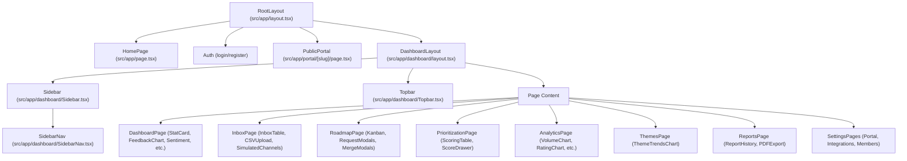

# LOOP — UI & UX Redesign Blueprint (Google Stitch Source of Truth)

**Document Version:** 1.0.0  
**Status:** Complete Audit & Redesign Master Specification  
**Target Repository:** `c:\Users\Shrey\LOOP`  
**Generated For:** Google Stitch Prompting & Production Frontend Implementation  

---

## 1. Project Overview & Verified Technology Stack

### Product Vision
**LOOP** is an AI-powered Feedback-to-Roadmap platform for indie hackers and SaaS founders.
*Promise:* "LOOP helps SaaS founders turn scattered customer feedback into evidence-backed product decisions and close the loop with customers."

### Verified Core Stack
- **Framework:** Next.js 14.2.35 (App Router, Server Components + Client Components)
- **UI Library:** React 18, Tailwind CSS 3.4.1, PostCSS
- **Type System:** TypeScript 5 (Strict Mode)
- **Data & ORM:** Prisma Client 7.10.0 with PostgreSQL hosted on Neon
- **Authentication:** NextAuth.js v4.24.15 (CredentialsProvider, JWT session strategy, bcryptjs 3.0.3)
- **Data Visualization:** Recharts 3.10.1
- **AI & Classification:** Anthropic Claude API (`@anthropic-ai/sdk` 0.125.0) with local deterministic cosine fallback
- **Exporting:** PDFKit 0.20.2 for VoC report generation
- **Email Infrastructure:** Resend REST API integration with HMAC-SHA256 unsubscribe signatures

---

## 2. Complete Route & Page Inventory

| Route Path | Type | File Location | Purpose & Verified Status |
| :--- | :--- | :--- | :--- |
| `/` | Public Page | `src/app/page.tsx` | Marketing Landing Page with hero, workflow pillars, mock UI, and CTA. |
| `/login` | Public Auth | `src/app/(auth)/login/page.tsx` | Credentials sign-in page with split marketing banner and social login mock. |
| `/register` | Public Auth | `src/app/(auth)/register/page.tsx` | Workspace creation & admin onboarding page. |
| `/dashboard` | Private App | `src/app/dashboard/page.tsx` | Founder Overview: Close-the-loop workflow, KPI cards, charts, recent feedback. |
| `/dashboard/inbox` | Private App | `src/app/dashboard/inbox/page.tsx` | Unified feedback inbox with filters, search, rating filter, pagination, CSV import, and channel simulation. |
| `/dashboard/inbox/[id]` | Private App | `src/app/dashboard/inbox/[id]/page.tsx` | Feedback inspection, sentiment score, AI reclassification, status updater, deletion. |
| `/dashboard/roadmap` | Private App | `src/app/dashboard/roadmap/page.tsx` | Internal feature request backlog, status updates, release notes, effort/impact, duplicate linking. |
| `/dashboard/prioritization` | Private App | `src/app/dashboard/prioritization/page.tsx` | Evidence-based scoring matrix: `(Votes*3) + Recency + Feedback + (Impact*5) - (Effort*3)`. |
| `/dashboard/analytics` | Private App | `src/app/dashboard/analytics/page.tsx` | Deep analytics: Volume over time, sentiment distribution, channels, rating stars, theme impact. |
| `/dashboard/themes` | Private App | `src/app/dashboard/themes/page.tsx` | AI-detected feedback themes, sentiment breakdown, 30-day trends, and volume spikes. |
| `/dashboard/ask` | Private App | `src/app/dashboard/ask/page.tsx` | Natural language Ask LOOP interface powered by semantic search and Claude. |
| `/dashboard/reports` | Private App | `src/app/dashboard/reports/page.tsx` | Executive Voice-of-Customer report generator, history list, and PDF download. |
| `/dashboard/members` | Private App | `src/app/dashboard/members/page.tsx` | Team management: Admin/Analyst/Viewer member list and invitation modal. |
| `/dashboard/settings` | Private App | `src/app/dashboard/settings/page.tsx` | Central settings hub: Workspace info, user profile, notification preferences, navigation cards. |
| `/dashboard/settings/portal` | Private App | `src/app/dashboard/settings/portal/page.tsx` | Public portal branding, custom slug, accent color, and weekly founder digest configuration. |
| `/dashboard/settings/integrations` | Private App | `src/app/dashboard/settings/integrations/page.tsx` | API key generator, copyable webhook endpoint, curl instructions, and website widget embed. |
| `/dashboard/settings/users` | Private App | `src/app/dashboard/settings/users/page.tsx` | Legacy placeholder page displaying static "Welcome Admin". |
| `/portal/[slug]` | Public Board | `src/app/portal/[slug]/page.tsx` | Customer-facing portal with tabs: Board (voting/submitting), Roadmap (Kanban), Changelog (satisfaction). |
| `/portal/[slug]/roadmap` | Public Redirect | `src/app/portal/[slug]/roadmap/page.tsx` | Redirects to `/portal/[slug]?tab=roadmap`. |
| `/portal/[slug]/changelog` | Public Redirect | `src/app/portal/[slug]/changelog/page.tsx` | Redirects to `/portal/[slug]?tab=changelog`. |

---

## 3. Existing Component & Layout Hierarchy



---

## 4. Authentication, Roles & User Workflows

### User Roles & Permissions
1. **ADMIN:**
   - Full access to all screens.
   - Exclusive access to: `/dashboard/members`, `/dashboard/settings/*`, invite team, regenerate API keys, configure weekly email digest.
2. **ANALYST:**
   - Operational access: Feedback Inbox, Reclassification, Roadmap status updates, Evidence Prioritization, Themes, Ask LOOP, Reports generation.
   - Restricted: Cannot access Members or Settings.
3. **VIEWER:**
   - Read-only access: Dashboard overview, Feedback inbox (cannot delete or reclassify), Roadmap (cannot update status or merge), Themes.
   - Hidden from navigation: Prioritization, Analytics, Ask LOOP, Reports, Members, Settings.

### Core User Workflows
- **Flow A (Feedback Ingestion):** Customer submits via `/portal/[slug]` OR webhook ingests -> Feedback arrives in `/dashboard/inbox` -> AI auto-classifies sentiment & theme -> Stored in database.
- **Flow B (Request Creation & Duplicate Detection):** Customer writes request title in portal -> Live debounced check queries `/api/portal/[slug]/check-duplicates` -> Shows matching ideas to vote on -> If distinct, creates new request.
- **Flow C (Evidence-Based Prioritization):** Founder visits `/dashboard/prioritization` -> Algorithm computes transparent score -> Founder adjusts impact/effort -> Top requests move to Roadmap.
- **Flow D (Closing The Loop):** Founder updates status to `SHIPPED` on `/dashboard/roadmap` with release notes -> System asynchronously notifies subscribed voters via email -> Shipped request appears on public Changelog -> Customers provide follow-up satisfaction rating.

---

## 5. Confirmed Page-to-API Mapping

| Screen / Page | Triggered Action | API Endpoint & Method | Status & Payload |
| :--- | :--- | :--- | :--- |
| `/login` | Submit credentials | `/api/auth/[...nextauth]` (`POST`) | Standard NextAuth credentials verification |
| `/register` | Create account & workspace | `/api/auth/register` (`POST`) | `{ name, workspaceName, email, password }` |
| `/dashboard` | Page load (SSR) | Direct Prisma database queries | Workspace statistics, 7-day counts, top channels |
| `/dashboard/inbox` | Import CSV | `/api/feedback/import` (`POST`) | `FormData` with CSV file |
| `/dashboard/inbox` | Generate dummy test data | `/api/feedback/simulate` (`POST`) | `{ channel: "APP_REVIEWS" \| "SUPPORT_TICKETS" ... }` |
| `/dashboard/inbox/[id]` | Reclassify AI sentiment | `/api/feedback/[id]/reclassify` (`POST`) | Runs classifier and updates themes/sentiment |
| `/dashboard/inbox/[id]` | Change review status | `/api/feedback/[id]/status` (`PATCH`) | `{ status: "NEW" \| "REVIEWED" \| "ACTIONED" }` |
| `/dashboard/inbox/[id]` | Delete feedback item | `/api/feedback/[id]` (`DELETE`) | Deletes feedback record and relations |
| `/dashboard/roadmap` | Fetch roadmap backlog | `/api/roadmap` (`GET`) | Returns requests with duplicates and vote counts |
| `/dashboard/roadmap` | Create backlog request | `/api/roadmap` (`POST`) | `{ title, description, category, status }` |
| `/dashboard/roadmap` | Update status & release note | `/api/roadmap/requests/[id]` (`PATCH`) | `{ status, releaseNote, effort, impact }` |
| `/dashboard/roadmap` | Link/Unlink duplicate request| `/api/roadmap/requests/[id]/merge` (`POST`)| `{ canonicalRequestId, reason, unlink? }` |
| `/dashboard/prioritization`| Calculate evidence ranks | `/api/prioritization` (`GET`) | Computes algorithmic score across backlog |
| `/dashboard/prioritization`| Adjust impact or effort | `/api/roadmap/requests/[id]` (`PATCH`) | `{ impact: 1-5, effort: 1-5 }` |
| `/dashboard/ask` | Query AI assistant | `/api/insights/ask` (`POST`) | `{ question: string }` -> returns answer & citations |
| `/dashboard/reports` | Generate VoC report | `/api/reports/generate` (`POST`) | Generates markdown synthesis via Claude |
| `/dashboard/reports` | Download PDF | `/api/reports/[id]/pdf` (`GET`) | Streams binary PDFKit generated document |
| `/dashboard/members` | Invite new user | `/api/members` (`POST`) | `{ name, email, password, role }` |
| `/dashboard/settings/portal`| Fetch settings | `/api/portal-settings` (`GET`) | Returns workspace portal and digest settings |
| `/dashboard/settings/portal`| Save settings | `/api/portal-settings` (`PATCH`) | `{ slug, portalEnabled, portalName, digestEmail... }` |
| `/dashboard/settings/portal`| Send test digest | `/api/cron/digest?sendTest=true` (`GET`) | Dispatches real email test and surfaces errors |
| `/dashboard/settings/integrations`| Regenerate API Key | `/api/portal-settings` (`PATCH`) | `{ regenerateApiKey: true }` |
| `/portal/[slug]` | Upvote request | `/api/portal/[slug]/requests/[id]/vote` (`POST`) | `{ voterToken, voterEmail?, notifyOnUpdate? }` |
| `/portal/[slug]` | Submit follow-up rating | `/api/portal/[slug]/requests/[id]/follow-up` (`POST`)| `{ satisfied: boolean, comment?, authorEmail? }` |

---

## 6. Current Design System Audit & Visual Inconsistencies

### Typography Flaws
- In `src/app/layout.tsx`, Geist Sans and Geist Mono are imported, but `tailwind.config.ts` fails to map them to the default font family.
- In `src/app/globals.css`, `body` explicitly falls back to `font-family: Arial, Helvetica, sans-serif;`, completely bypassing modern typography.
- Mixed font weights across headings (`font-bold`, `font-semibold`, `tracking-tight`, unstandardized tracking).

### Color & Palette Fragmentations
- Violet is defined arbitrarily across components: `#6655e8`, `#5847d8`, `bg-violet-600`, `bg-purple-600`, `bg-indigo-600`.
- Dark backgrounds use conflicting dark blues: `#101631`, `#0b1026`, and `#201c4b`.
- Borders switch randomly between `border-gray-100`, `border-gray-200`, `border-slate-200`, and `border-purple-100`.

### Layout & Component Inconsistencies
1. **Double Main Wrapper:** `DashboardLayout` wraps children in `<main className="p-4 sm:p-6">`, while `DashboardPage` and `InboxPage` nest another `<main className="min-h-screen bg-gray-50 p-8">`, causing double padding and jagged scrolling.
2. **Topbar Issues:** Line 24 & 28 of `Topbar.tsx` render two identical duplicate bell notification icons (`🔔 🔔`). Search bar is static and non-functional. Avatar `"S"` is hardcoded.
3. **Sidebar Issues:** Workspace title is hardcoded to "Acme Inc." instead of reading `session.user.workspaceName`. Inbox badge is hardcoded to `"120"`.
4. **Broken Links:** `QuickActions.tsx` links to `/dashboard/ask-loop` (returns 404; true path is `/dashboard/ask`). Settings page links to `/dashboard/settings/users` (dummy placeholder) instead of `/dashboard/members`.
5. **Brand Logo Inconsistency:** The logo mark `◉ LOOP` is duplicated inline across 5 different files rather than using a single unified `<Logo />` component.

---

## 7. Recommended Premium SaaS Design System

### 1. Typography Hierarchy (Inter or Geist)
- **Primary Font:** Geist Sans / Inter (`font-sans`)
- **Monospace Font:** Geist Mono / JetBrains Mono (`font-mono`)
- **Display 1 (Landing):** `text-5xl md:text-6xl font-extrabold tracking-tight leading-[1.1]`
- **Heading 1 (Page Titles):** `text-2xl font-bold text-slate-900 tracking-tight`
- **Heading 2 (Card / Section Titles):** `text-base font-semibold text-slate-900`
- **Heading 3 (Subheadings / Group Headers):** `text-xs font-bold uppercase tracking-wider text-slate-500`
- **Body Regular:** `text-sm font-normal text-slate-600 leading-relaxed`
- **Body Small:** `text-xs font-normal text-slate-500`
- **Labels & Microcopy:** `text-[11px] font-semibold text-slate-400 uppercase tracking-wide`

### 2. Cohesive Color Tokens
```css
/* Core Brand Colors */
--primary-50:  #f5f3ff;
--primary-100: #ede9fe;
--primary-500: #7c3aed;
--primary-600: #6d28d9; /* Main Accent */
--primary-700: #5b21b6;

/* Slate Neutrals */
--slate-50:  #f8fafc; /* Background */
--slate-100: #f1f5f9; /* Surface muted */
--slate-200: #e2e8f0; /* Default border */
--slate-300: #cbd5e1;
--slate-600: #475569; /* Body text */
--slate-800: #1e293b;
--slate-900: #0f172a; /* Main headings */

/* Semantic Status Badges */
--under-review: #f59e0b; /* Amber */
--planned:      #3b82f6; /* Blue */
--in-progress:  #8b5cf6; /* Violet */
--shipped:      #10b981; /* Emerald */
--not-planned:  #64748b; /* Slate */
```

### 3. Component Specs
- **Buttons:**
  - *Primary:* `h-9 px-4 rounded-lg bg-violet-600 text-white font-medium text-xs shadow-sm hover:bg-violet-700 active:scale-[0.98] transition-all disabled:opacity-50`
  - *Secondary / Outline:* `h-9 px-4 rounded-lg border border-slate-200 bg-white text-slate-700 font-medium text-xs shadow-xs hover:bg-slate-50 hover:border-slate-300 transition-all`
  - *Danger:* `h-9 px-4 rounded-lg bg-rose-50 text-rose-600 border border-rose-200 font-medium text-xs hover:bg-rose-100`
- **Cards & Surfaces:**
  - `rounded-xl border border-slate-200/80 bg-white p-5 shadow-xs hover:shadow-sm transition-shadow`
- **Data Tables:**
  - Header: `bg-slate-50/80 border-b border-slate-200 text-[11px] font-semibold text-slate-500 uppercase tracking-wider px-4 py-3`
  - Row: `border-b border-slate-100 hover:bg-slate-50/50 transition-colors px-4 py-3.5 text-xs text-slate-700`
- **Form Controls:**
  - Input: `h-9 w-full rounded-lg border border-slate-200 bg-white px-3 text-xs text-slate-800 placeholder:text-slate-400 focus:outline-none focus:border-violet-600 focus:ring-2 focus:ring-violet-100 transition-all`
- **Status Badges:**
  - `inline-flex items-center gap-1.5 px-2.5 py-0.5 rounded-full text-[11px] font-semibold`

---

## 8. Screen-by-Screen Redesign Specifications

### Screen 1: Dashboard Overview (`/dashboard`)
- **Purpose:** Central command center for founders to view feedback velocity, sentiment health, top requested features, and close-the-loop progress.
- **Header:** Personalized greeting (`Welcome back, {name}`), active workspace badge, date range selector.
- **Hero Workflow Card (Close The Loop):** Interactive 4-step progress bar (Collect -> Portal -> Prioritize -> Close Loop) with live counts and quick action buttons.
- **Metrics Grid (5 KPIs):** Total Feedback, Positive Sentiment %, Negative %, Neutral %, New This Week (with sparkline indicators).
- **Two-Column Analytics:**
  - *Left:* Feedback Volume (7-day Recharts area chart with smooth gradient).
  - *Right:* Sentiment Breakdown (interactive Donut chart with legend).
- **Channels & Themes Row:** Top Channels bar list paired side-by-side with Top Themes progress indicators.
- **Recent Feedback Feed:** Clean table showing snippet, source icon, sentiment pill, and direct link to inspect.

### Screen 2: Feedback Inbox (`/dashboard/inbox`)
- **Purpose:** Filterable, searchable repository of all incoming raw customer feedback.
- **Toolbar:** Global text search input, Source dropdown (Website, Email, Support, Survey), Sentiment dropdown, Status filter, Star rating selector (1-5), and Date presets.
- **Header Actions:** "Upload CSV" button and "Simulate Feedback" dropdown.
- **Inbox Table:**
  - Columns: Select checkbox, Feedback snippet, Channel pill, Star rating, Sentiment badge, Review status, Date received, Actions (View, Delete).
- **Pagination:** Modern footer displaying "Showing X to Y of Z results", page size selector, and Prev/Next buttons.

### Screen 3: Feedback Inspection & Detail (`/dashboard/inbox/[id]`)
- **Purpose:** Deep dive into customer comment, view AI sentiment score, edit themes, and reclassify.
- **Layout:** Two-column split view (Customer Feedback card on left, AI Analysis & Metadata on right).
- **Left Panel:** Complete content text, author metadata (if available), source details, star rating.
- **Right Panel:**
  - Sentiment confidence meter (0.0 to 1.0 score bar).
  - Associated theme tags with remove/add capabilities.
  - "Re-classify with AI" trigger button with spinner.
  - Status updater selector (`NEW`, `REVIEWED`, `ACTIONED`).
  - Danger zone: "Delete feedback" modal trigger.

### Screen 4: Roadmap Backlog (`/dashboard/roadmap`)
- **Purpose:** Internal backlog where founders prioritize requests, write release notes, and publish progress.
- **Views:** Switchable between Kanban Board (Columns: Under Review, Planned, In Progress, Shipped, Not Planned) and List Table.
- **Kanban Card:** Title, category badge, vote count pill, duplicate indicator, effort/impact rating stars, quick status dropdown.
- **Request Detail / Edit Drawer:**
  - Title & description editor.
  - Effort (1-5) and Impact (1-5) sliders.
  - Status selector.
  - *When Shipped:* Release note rich text area with "Notify X subscribed customers" checkbox.
  - *Duplicate Management Section:* Displays linked duplicates and "Link Another Request" search modal.

### Screen 5: Evidence-Based Prioritization (`/dashboard/prioritization`)
- **Purpose:** Transparent ranking table that calculates what to build next based on customer proof.
- **Formula Banner:** Clear explanation of algorithm weights: `(Votes * 3) + Recency + Feedback + (Impact * 5) - (Effort * 3)`.
- **Ranking Table:**
  - Columns: Rank #, Request Title, Public Status, Upvotes, Related Feedback count, Impact slider, Effort slider, Total Score badge, Evidence button.
- **Evidence Drawer:** Slide-over modal opening upon click, showing breakdown of points (how many points came from votes, recency days, and linked feedback items).

### Screen 6: Deep Analytics (`/dashboard/analytics`)
- **Purpose:** Executive data visualization of customer trends over 7, 30, or 90 days.
- **Charts:**
  - Volume trend (Area chart).
  - Sentiment breakdown over time (Stacked bar chart).
  - Channel distribution (Horizontal bar chart).
  - CSAT / Star rating distribution (Bar chart 1 to 5 stars).
  - Theme Impact Matrix (Bubble chart or ranked list of negative themes).

### Screen 7: AI Themes & Trends (`/dashboard/themes`)
- **Purpose:** Clustered feedback topics detected by AI with velocity detection.
- **Cards Grid:** Theme name, total volume, sentiment ratio bar, 30-day velocity indicator (+X% spike), "View all feedback" filter link.

### Screen 8: Ask LOOP (`/dashboard/ask`)
- **Purpose:** Natural language query interface to chat with your customer feedback database.
- **Interface:** Clean chat box with suggested query pills ("Why are users churning?", "What features are requested for billing?").
- **Answer Display:** Markdown rendered response with verified citation cards citing exact feedback quotes and customer sentiment.

### Screen 9: Executive Reports (`/dashboard/reports`)
- **Purpose:** Auto-generated Voice-of-Customer reports for founders and stakeholders.
- **Layout:** Sidebar of past report dates + Main viewer displaying executive summary, key customer requests, top friction points, and "Download PDF" button.

### Screen 10: Public Customer Portal (`/portal/[slug]`)
- **Purpose:** White-labeled customer board where end-users submit ideas, upvote, and track shipped features.
- **Header:** Workspace branding (Logo, Portal Name, Tagline, Accent Color).
- **Navigation Tabs:**
  - *Board:* Feedback cards with clean upvote button (shows upvote animation and active state), search, and filter.
  - *Roadmap:* Public Kanban columns (Planned, In Progress, Shipped).
  - *Changelog:* Shipped releases with release notes and follow-up satisfaction widget ("Did this solve your problem? 👍 / 👎").
- **Submit Modal:** Title, description, category, optional customer email with "Notify me on update" checkbox. Includes real-time duplicate idea detection banner.

### Screen 11: Portal & Digest Settings (`/dashboard/settings/portal`)
- **Purpose:** Founder portal configuration and email settings.
- **Sections:**
  - Public Portal URL Slug (with live availability check).
  - Custom Branding (Portal Name, Tagline, Logo URL, Accent Color picker).
  - "Show Not Planned Requests" toggle.
  - Weekly Founder Digest: Recipient email, enable toggle, and "Send Test Digest" button with live provider diagnostics.

### Screen 12: Integrations & Webhooks (`/dashboard/settings/integrations`)
- **Purpose:** Developer tools to stream feedback into LOOP from external applications.
- **Sections:** Workspace API Key (masked with reveal and copy button, regenerate action), Webhook endpoint URL, curl code snippet with syntax highlighting, and HTML website widget script.

### Screen 13: Team Members (`/dashboard/members`)
- **Purpose:** Role-based access management for workspace staff.
- **Components:** Role summary cards (Admins, Analysts, Viewers count), member table with role badges, and "Invite Member" modal.

---

## 9. Responsive Layout Requirements

### Desktop (`>= 1024px`)
- Fixed 256px (`w-64`) left sidebar with brand logo, workspace switcher, and role-filtered navigation items.
- Topbar (`h-16`) containing global search, workspace status pill, notification center, and user profile avatar dropdown.
- Main content fluid container with max width `max-w-7xl` and balanced padding (`px-8 py-6`).

### Tablet (`768px - 1023px`)
- Collapsible sidebar or compact icon-rail navigation.
- Multi-column metric grids adapt from 5 columns down to 2 or 3 columns.
- Data tables enable horizontal scrolling with fixed first columns where needed.

### Mobile (`< 768px`)
- Sticky top header (`h-14`) with brand logo and hamburger menu button (`☰`).
- Off-canvas sliding drawer for navigation overlay with backdrop blur.
- Tables collapse to responsive stacked cards on mobile screens.
- Modals take full screen width with sticky bottom action buttons for thumb reachability.

---

## 10. Interactive Behavior & State Specifications

### Search & Filtering
- Search inputs must debounce at 300ms before triggering URL parameter updates or client-side filtering.
- Active filters display dismissible filter chips (`Source: Website ✕`, `Rating: 5 Stars ✕`) with a "Clear all" button.

### Form Validations
- Immediate inline error messages under invalid inputs (e.g., "Email must be valid", "Title must be at least 4 characters").
- Form submission buttons show spinning loading state and disable double-clicking.

### Modal Dialogs
- Click outside or pressing `Escape` closes the modal (except when actively submitting).
- Background scroll is locked when modals or slide-over drawers are open.

### Feedback Upvoting Micro-Interaction
- Upvote button shows immediate optimistic counter increment (`+1`) and violet fill animation.
- If request fails, state reverts smoothly with a non-intrusive error toast.

---

## 11. Complete State Inventory

| State | Visual Treatment & Guidelines |
| :--- | :--- |
| **Loading State** | Skeleton loaders matching the exact card/table row geometry. Never use blank white screens or abrupt full-page spinners. |
| **Empty State** | Illustrated empty card with clear icon, empathetic headline (e.g. "No feedback yet"), description, and primary CTA button. |
| **Error State** | Rose-tinted alert banner (`bg-rose-50 border-rose-200 text-rose-700`) with clear explanation and "Retry" button. |
| **Success State** | Subtle toast notification (bottom-right) or inline emerald banner with auto-dismiss after 4 seconds. |
| **Disabled State** | Opacity reduced to 50%, `cursor-not-allowed`, tooltips explaining why the action is disabled. |
| **Permission Denied** | Clean centered lock card: "Access Restricted: You need Administrator privileges to view this page" with "Back to Dashboard" button. |

---

## 12. Accessibility (a11y) Standards

- **Color Contrast:** All text must meet WCAG AA standards (minimum 4.5:1 for body text, 3:1 for large headings). Slate-600 on White provides 5.7:1 contrast ratio.
- **Focus Rings:** Visible focus ring on all interactive elements: `focus-visible:ring-2 focus-visible:ring-violet-600 focus-visible:ring-offset-2`.
- **Form Labels:** Every input must have an associated `<label>` or explicit `aria-label`.
- **Keyboard Navigation:** Modals trap keyboard focus. Menus support arrow key navigation.

---

## 13. Google Stitch Master Prompt

Copy and paste this master prompt into Google Stitch to generate the unified, high-fidelity design system for LOOP:

```markdown
Design a world-class, modern, high-density B2B SaaS web application called "LOOP" (AI-powered Customer Feedback Intelligence & Public Roadmap Platform).

Design Aesthetic & Philosophy:
- Visual Style: Linear/Vercel/Stripe-tier premium SaaS interface. Clean, modern, high-utility, understated elegance.
- Color Palette: Pure white surfaces (#ffffff) and subtle slate backgrounds (#f8fafc), crisp slate borders (#e2e8f0), deep slate typography (#0f172a), and a vibrant violet/purple primary brand accent (#6d28d9 and #7c3aed).
- Typography: Geist Sans or Inter with tight tracking on headings (-0.02em), clean tabular numbers for metrics and charts, and mono fonts for tokens and API snippets.
- Micro-interactions: Subtle borders, soft shadow layers (shadow-xs to shadow-sm), crisp hover states, smooth transitions, and distinct status pills.
- No tacky gradients, no bloated glassmorphism, no childish cartoon illustrations, no cluttered layouts.

Core Layout Architecture:
- Collapsible left sidebar (256px wide, dark slate #0b1026 with violet brand mark "◉ LOOP", active workspace switcher, role-aware navigation links, and notification badges).
- Sleek top header (64px high, global search bar with shortcut key badge ⌘K, notification bell, environment pill, and user profile avatar with dropdown).
- Responsive fluid main content canvas with balanced whitespace and breadcrumb navigation.

Design the complete screen system maintaining 100% visual and interactive consistency across private founder dashboards and customer-facing public boards.
```

---

## 14. Separate Copy-Ready Stitch Prompts by Module

### A. Dashboard Overview & Analytics Module
```markdown
Generate the Private Founder Dashboard & Analytics for "LOOP":
1. Executive Header: "Welcome back, {User}" with active workspace selector and 7-day/30-day/90-day time filters.
2. Close-the-Loop Workflow Widget: A 4-step interactive progress engine showing customer feedback collected, public portal status, prioritized requests, and shipped roadmap items.
3. 5 Key Metric Cards: Total Feedback (with sparkline), Positive Sentiment %, Negative %, Neutral %, and New Feedback this week.
4. Analytics Charts:
   - Recharts Area Chart: Feedback volume over time with violet gradient fill.
   - Recharts Donut Chart: Sentiment distribution with positive/neutral/negative legend.
   - Channel breakdown progress bars (Website, Email, Support, Survey).
   - Top 5 trending customer themes with velocity badges (+24% spike).
5. Recent Feedback Activity Table: Compact rows with customer snippet, source badge, sentiment indicator, and quick-inspect action.
```

### B. Feedback Inbox & Detail Drawer Module
```markdown
Generate the Unified Feedback Inbox & Detail View for "LOOP":
1. Toolbar & Filter Bar: Debounced search bar, Channel pills (Website, Email, Support, Survey), Sentiment pills, Star Rating selector (1-5 stars), and Date range. Action buttons: "Import CSV" and "Simulate Feedback".
2. High-Density Data Table: Checkbox column, Customer comment snippet, Source icon, Sentiment badge (Positive=emerald, Neutral=slate, Negative=rose), Review status dropdown (New, Reviewed, Actioned), Star rating, and Date.
3. Feedback Detail Drawer (Slide-Over):
   - Full feedback quote with customer author details.
   - AI Sentiment Meter: Confidence bar (e.g. 94% Negative - Frustrated onboarding friction).
   - Theme Tags: Associated AI themes with "Add Theme" tag input.
   - "Re-classify with AI" button with active processing spinner.
   - Delete feedback action with destructive confirmation modal.
```

### C. Themes, Ask LOOP & VoC Reports Module
```markdown
Generate the AI Intelligence Suite for "LOOP":
1. Themes Page: Responsive grid of AI-detected theme cards showing topic title, feedback count, sentiment breakdown bar, and 30-day velocity indicator (+32% spike badge).
2. Ask LOOP Interface: Sleek conversational query box with quick-prompt chips ("Why do users churn?", "Most requested integrations"). Clean response card rendering AI answers with expandable citation quotes linking to real customer feedback.
3. Voice of Customer Reports: Left sidebar with historical report dates. Main area showing structured AI executive summary, key customer requests, top complaints, and "Download PDF" button.
```

### D. Public Feedback Portal & Voting Module
```markdown
Generate the Customer-Facing Public Feedback Portal for "LOOP":
1. Branded Header: Workspace logo, portal name, customizable tagline, and workspace accent color.
2. Navigation Tabs: "Feature Board", "Roadmap", and "Changelog".
3. Feature Board:
   - Search bar and status filter dropdown.
   - Submit Feature Request button opening modal with real-time duplicate idea detection banner.
   - Feature Request Cards: Clean voting pill on left (upvote arrow + vote count with active state), idea title, description, category badge, and status pill.
4. Changelog Tab: Shipped feature timeline with founder release notes and an interactive satisfaction feedback widget ("Did this solve your problem? 👍 Yes / 👎 No").
```

### E. Internal Roadmap & Duplicate Linking Module
```markdown
Generate the Founder Roadmap & Backlog Management Screen for "LOOP":
1. View Toggle: Switch between Kanban Board (Columns: Under Review, Planned, In Progress, Shipped, Not Planned) and List View.
2. Kanban Cards: Request title, category tag, vote count, effort/impact rating (1-5 stars), and duplicate badge (e.g., "3 merged duplicates").
3. Edit Request Modal:
   - Status selector dropdown.
   - Impact slider (1-5) and Effort slider (1-5).
   - Release note editor for Shipped items with "Notify X subscribed customers" checkbox.
   - Duplicate Linking Drawer: Search existing requests to link duplicate ideas into a canonical request, pooling votes and customer subscribers.
```

### F. Evidence-Based Prioritization Module
```markdown
Generate the Evidence-Based Prioritization Matrix for "LOOP":
1. Formula Header Banner: Explaining the transparent scoring algorithm:
   Score = (Votes × 3) + Recency (up to 15) + Related Feedback (up to 30) + (Impact × 5) − (Effort × 3).
2. Prioritization Table:
   - Columns: Rank #, Feature Request Title, Public Status, Upvotes, Related Feedback count, Impact rating (1-5), Effort rating (1-5), Total Score pill.
   - Evidence Action: Clickable button opening a slide-over drawer detailing the mathematical point breakdown for that request.
```

### G. Workspace Settings, Team & Portal Settings Module
```markdown
Generate the Administrative Settings Suite for "LOOP":
1. Settings Navigation: Clean tabbed or card navigation for Workspace, Portal Branding, Integrations, and Team Members.
2. Portal & Digest Settings Screen:
   - Portal slug input with live domain preview (`loop.com/portal/{slug}`).
   - Branding fields: Portal name, logo URL, description, accent color picker.
   - Weekly Founder Digest Card: Toggle switch, recipient email input, and "Send Test Digest" button with real provider status alerts.
3. Integrations Screen: API Key generator with reveal/copy actions, incoming webhook URL, and curl snippet.
4. Team Members Screen: Role breakdown cards (Admins, Analysts, Viewers) and user list with "Invite Member" modal.
```

### H. Authentication & Responsive Shell Module
```markdown
Generate the Responsive Application Shell & Auth for "LOOP":
1. Login Screen: Split layout with marketing visual on left and clean credentials form on right with remember-me, forgot-password, and email/password inputs.
2. Register Screen: Workspace setup form collecting user name, workspace name, email, and password.
3. Mobile Shell: Sticky mobile header with "◉ LOOP" brand mark, hamburger menu opening full-height slide-out navigation, and mobile-optimized card layouts.
```

---

## 15. Implementation Checklist: Approved Designs to Code

- [ ] **Design Tokens & Fonts:** Update `src/app/globals.css` and `tailwind.config.ts` to map Geist Sans and Geist Mono variables to `font-family`.
- [ ] **Shared Logo Component:** Create `src/components/brand/LoopLogo.tsx` and replace inline `◉ LOOP` instances across landing, login, register, sidebar, and emails.
- [ ] **Topbar Cleanup:** Remove duplicate bell icon in `src/app/dashboard/Topbar.tsx`, connect functional user profile dropdown, and remove hardcoded avatar.
- [ ] **Sidebar Workspace Binding:** Bind workspace name dynamically to `session.user.workspaceName` in `src/app/dashboard/Sidebar.tsx`.
- [ ] **Fix Broken Dashboard Links:** Update `src/app/dashboard/QuickActions.tsx` route to `/dashboard/ask` and redirect `/dashboard/settings/users` to `/dashboard/members`.
- [ ] **Resolve Double Main Container:** Standardize page wrappers between `src/app/dashboard/layout.tsx` and individual dashboard pages.
- [ ] **Inbox Multi-Tenant Query:** Add `where: { workspaceId }` to `src/app/dashboard/inbox/page.tsx` and `src/app/dashboard/inbox/[id]/page.tsx`.
- [ ] **Roadmap UI Redesign:** Implement Kanban board view and status change release note modal.
- [ ] **Prioritization Evidence Modal:** Integrate mathematical breakdown drawer into `src/app/dashboard/prioritization/page.tsx`.
- [ ] **Public Portal Design Polish:** Enhance voting animation and follow-up satisfaction rating component in `src/app/portal/[slug]/page.tsx`.

---

## 16. Unknowns & Decisions Requiring Confirmation

1. **Google OAuth Strategy:** `src/app/(auth)/login/page.tsx` renders a "Continue with Google" button, but Google OAuth is not configured in `src/auth.ts`. *Decision needed:* Should Google OAuth credentials be added, or should the social button be replaced with pure credentials sign-in?
2. **Billing & Tier Limits:** Topbar displays an "Upgrade" button and landing page mentions pricing, but Stripe/billing models do not exist in the database. *Decision needed:* Should billing be mocked with an upgrade modal, or hidden until v2?
3. **Email Sending Domain:** Resend free tier (`onboarding@resend.dev`) only allows delivery to the account owner's email address. Sending status notifications to real customer emails requires a verified custom domain or SMTP relay.
4. **CSV Export Feature:** While CSV import exists, founders frequently ask for a "Export Feedback to CSV" button. *Decision needed:* Should a CSV export route be added to the inbox redesign?
